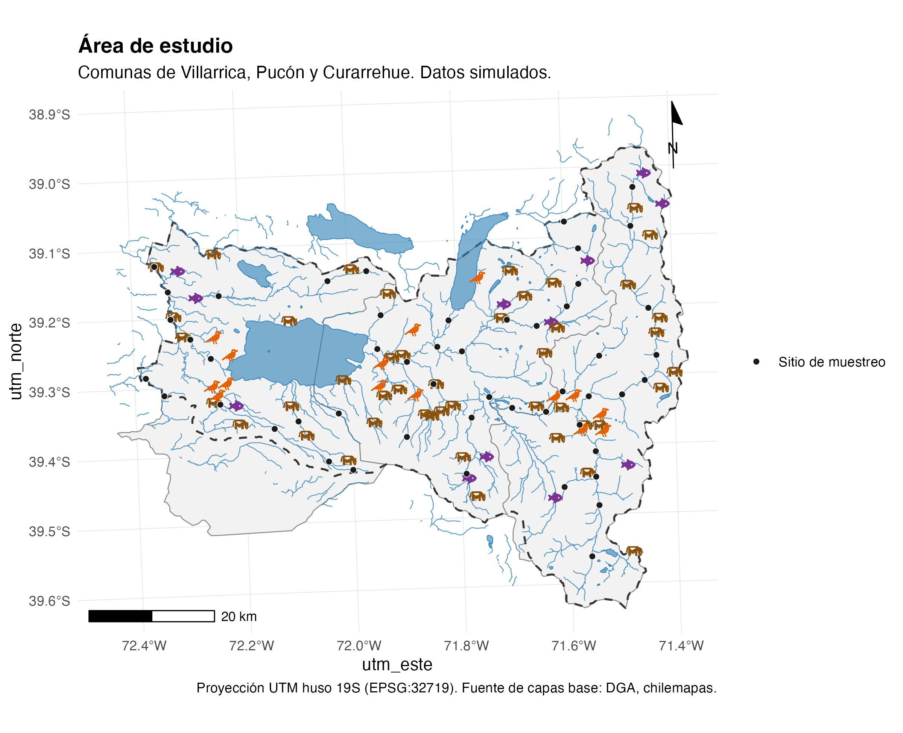

::: callout-warning
## Datos simulados

Aún no se han recolectado datos de terreno. Todas las tablas, mapas y gráficos de este sitio provienen de una base de datos **simulada** y tienen fines ilustrativos y metodológicos. **No son resultados reales** del estudio.
:::

# Introducción

<!-- TODO: contexto breve (2-4 líneas): por qué importa el visón americano en esta zona. -->

**Pregunta de investigación:** <!-- TODO: escribir con tus palabras -->

**Hipótesis:** <!-- TODO: escribir con tus palabras -->

# Área de estudio

El estudio se ubica desde las proximidades del Lago Villarrica hasta la cordillera, en las comunas de **Villarrica, Pucón y Curarrehue** (Región de La Araucanía). Incluye los ríos Trancura, Liucura y Pucón con sus afluentes, además del río Toltén aguas abajo del lago. Las coordenadas están en UTM huso 19S.

<!-- Mapa: se genera con scripts/04_mapa_area_estudio.R y se guarda en figures/ -->

<!--  -->

*(Mapa en preparación.)*

# Métodos

## Diseño de muestreo

Se registra la presencia o ausencia de visón en sitios ribereños mediante cuatro métodos de detección: huellas, fecas, cámaras trampa y avistamiento.

<!-- TODO: número de sitios, criterio de selección, esfuerzo de muestreo, visitas repetidas. -->

## Datos simulados

<!-- TODO: explicar qué parámetros se simularon (ver data/simulacion/parametros_simulacion.csv) y por qué. -->

## Variables

<!-- TODO: variable respuesta (presencia/ausencia) y predictora principal (distancia a centros productivos). -->

# Datos

Flujo de trabajo, desde los datos crudos hasta la tabla analizable:

1.  Preparación de capas base (`00_preparar_capas.R`)
2.  Simulación de centros productivos (`01_simular_centros_productivos.R`)
3.  Simulación del muestreo (`02_simular_muestreo.R`)
4.  Limpieza de datos (`03_limpiar_datos.R`)

<!-- TODO: tabla resumen de la limpieza (data/clean/registro_limpieza.csv) y enlace al diccionario de datos. -->

# Resultados (ilustrativos)

::: callout-note
Esta sección usa datos simulados. Sirve para mostrar cómo se presentarán los resultados cuando existan datos reales.
:::

## Exploración de los datos

<!-- TODO: número de sitios y visitas, detecciones por método. -->

## Presencia de visón y distancia a centros productivos

<!-- TODO: figura principal y, más adelante, modelo. -->

# Discusión y próximos pasos

<!-- TODO: limitaciones del diseño y de la simulación; plan de campaña de terreno. -->

# Reproducibilidad

Todo el código y los datos están en el [repositorio de GitHub](https://github.com/MaximilianoRosales/analisis_vison_tesis). Para regenerar la base de datos simulada, ejecuta `scripts/ejecutar_todo.R` desde la raíz del proyecto.
